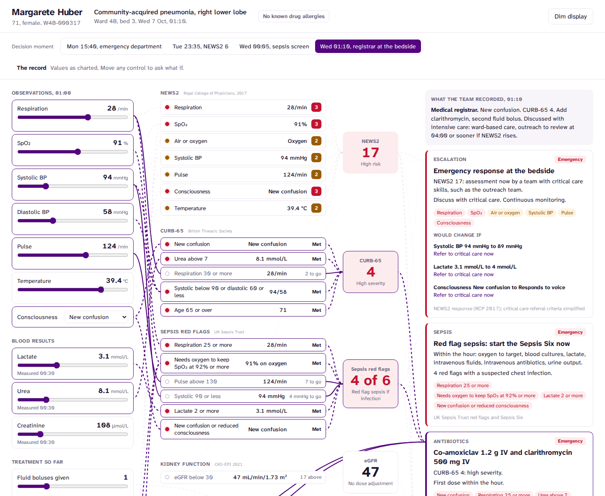
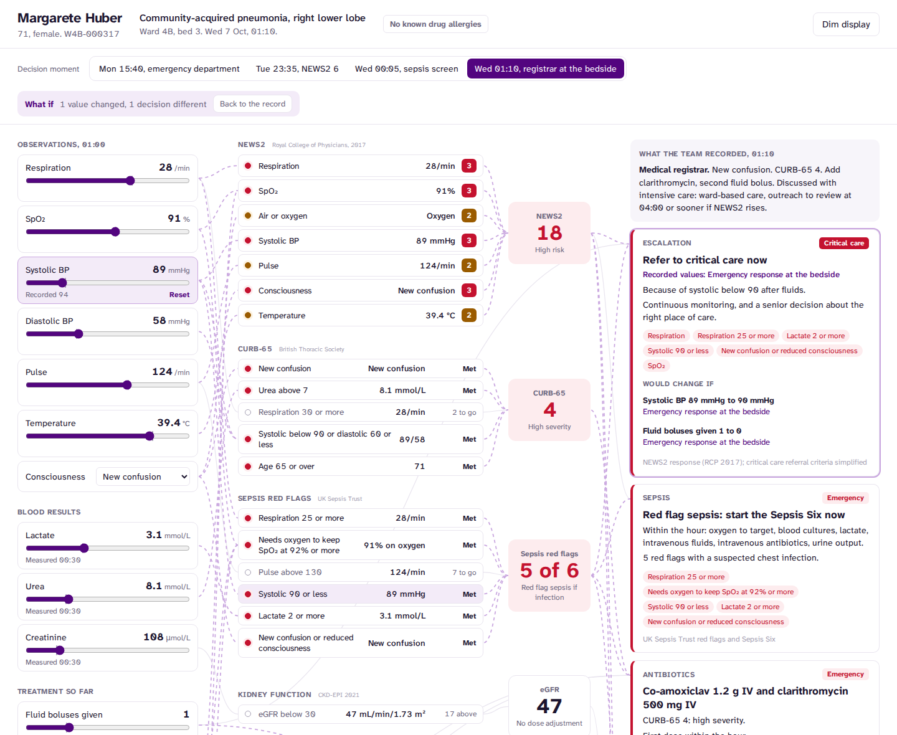
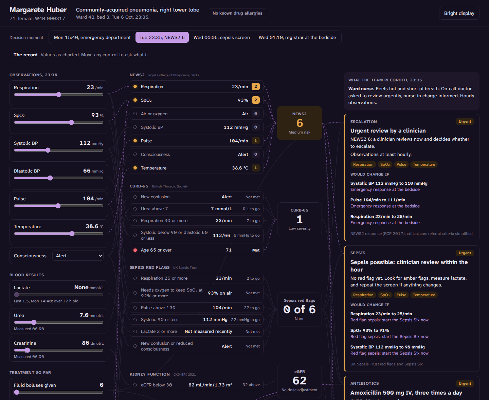

# Decision cockpit

Live: https://decision-cockpit-eosin.vercel.app

Clinical decision rules drawn as live circuits. A patient's values flow through NEWS2, CURB-65,
the sepsis red flags and kidney function into six bedside decisions. Every lit wire is a reason,
and every decision shows the smallest change that would turn it into a different one.



Decision support usually fails in one of two ways. Either it is a black box that outputs a score
nobody can argue with, or it is an alert that fires without saying why. This cockpit does the
opposite. It shows the whole chain from a measured value to a recommendation, and lets you push
on it.

- **Rules as circuits.** Each criterion is a node that lights when it is met. It shows its value
  and how far it is from firing ("pulse 124, 7 to go"). Wires carry what is met into each score,
  and from the scores into the decisions. Hover any node to trace what it depends on and what
  depends on it.
- **What if.** Every value is a control, with the charted value marked on its track. Drag the
  systolic from 94 to 89 and the escalation turns from an emergency response into a referral to
  critical care. The changed decision says what it was on the recorded values. A what-if
  scenario lives in the URL, so it can be shared.
- **Tipping points.** For each decision, the cockpit finds the smallest single change to any
  input that would change the recommendation, by walking each input away from its value in both
  directions. At 01:10 escalation is 5 mmHg of systolic, or 0.9 mmol/L of lactate, away from
  critical care. Click a tipping point to try it.
- **Checked against the record.** It uses the same fictional patient as the
  [ward monitor](https://github.com/Henrycarto/ward-monitor) and the
  [patient timeline](https://github.com/Henrycarto/patient-timeline). At each of the four moments
  in her notes where a decision was made, the cockpit reads her charted values and shows what
  the team wrote beside what the rules recommend.



## The four moments

| Moment | Charted | The rules recommend | The team recorded |
|---|---|---|---|
| Mon 15:40, emergency department | NEWS2 3, CURB-65 1 | Oral amoxicillin, ward care | Oral amoxicillin, admitted |
| Tue 23:35, after vomiting her 22:00 tablets | NEWS2 6, no lactate for 33 hours | Urgent review; give the lost amoxicillin dose intravenously; start oxygen | Doctor asked to review, hourly observations |
| Wed 00:05 | NEWS2 10, 2 red flags | Red flag sepsis, Sepsis Six, measure lactate, high-severity antibiotics | Sepsis screen positive, outreach called |
| Wed 01:10, registrar | NEWS2 17, CURB-65 4, 4 red flags, lactate 3.1 | Emergency response and discuss with critical care; co-amoxiclav and clarithromycin; second bolus; hold atorvastatin and amlodipine | All of these, across the registrar's note and the next morning |

The second row is the honest one. The rules would have replaced the vomited antibiotic dose
straight away. In the record no antibiotic reached her for nearly 11 hours, until the sepsis
response.

## The rules

Each one is simplified from its source, implemented as a pure function and tested at its
thresholds from both sides.

- **NEWS2** (Royal College of Physicians, 2017), with SpO₂ scale 2 when there is a risk of
  hypercapnic respiratory failure.
- **CURB-65** (British Thoracic Society). It scores as CRB-65 when urea has not been measured.
- **Sepsis red flags** (UK Sepsis Trust), the six a ward chart can show: respiration 25 or
  more, oxygen needed to keep SpO₂ at 92% (88% with hypercapnic risk), pulse above 130,
  systolic 90 or less, lactate 2 or more, and new confusion. A lactate older than 12 hours
  counts as not measured.
- **eGFR**, CKD-EPI 2021, checked against hand-worked values.

The six decisions:

| Decision | Built from |
|---|---|
| Escalation | NEWS2 response bands, plus critical care referral for lactate 4 or more, systolic below 90 after fluids, or a falling level of consciousness |
| Sepsis | Red flags, or NEWS2 5 or more with no red flag |
| Antibiotics | Severity by CURB-65, raised to high by red flag sepsis (NICE NG138 asks for clinical judgement alongside CURB-65), with penicillin allergy and intravenous alternatives |
| Fluids | 500 mL boluses for low pressure or high lactate, counted, with critical care after three |
| Oxygen | BTS targets of 94 to 98%, or 88 to 92% with hypercapnic risk |
| Medicine safety | Clarithromycin with atorvastatin, amlodipine with low blood pressure, renal dosing below eGFR 30, and doses that may not have been absorbed |

The wiring is structural: a decision is wired to every rule that can change it, whichever
branch fires. Only the lighting follows the current values.

## Tested

110 tests, including:

- Every NEWS2 band edge, CURB-65 and red flag threshold from both sides, including the strict
  "urea above 7".
- eGFR against hand-worked values.
- At each of the four moments, the inputs are read from the record and the recommendations
  match what the notes record.
- Every branch of every decision, including penicillin allergy at each severity, the third
  bolus and the hypercapnic oxygen target.
- Tipping points are the smallest change: one step short of each tipping point, the decision
  does not change. They never propose a diastolic within 10 of the systolic.
- Wiring: every wire reaches a real node, a decision traces back to every input that can change
  it, and an input traces forward only to the decisions it can reach.

Two bugs were caught by tests while building it. Wires were built from the branch that fired,
so a penicillin allergy that was switched off had no wire at all. And a test case of mine
claimed NEWS2 5 for values that add up to 4.

## Design

It uses the same design system as the ward monitor and the timeline: white, one purple for
interaction, and Atkinson Hyperlegible Next bundled with the app. Amber and red appear only
where a rule puts them, on criteria that are met, on scores in their alert bands and on
decision levels. Lit wires flow, unless the system asks for reduced motion. On a phone the
wires give way to a single column: decisions first, then the values, then the rules.



## Run it

```bash
npm install
npm run dev
npm test && npm run lint && npm run typecheck
npm run build          # static site in dist/
npm run build:single   # one self-contained HTML file in dist-single/
```

The patient record in `src/record/` is the same one the patient timeline uses.

## Not a medical device

A fictional patient and simplified rules, for demonstrating interface design and explainable
decision logic. It is not clinical guidance, it is not validated, and it must not be used to
make clinical decisions.

## Author

Samuel Henry Mba
